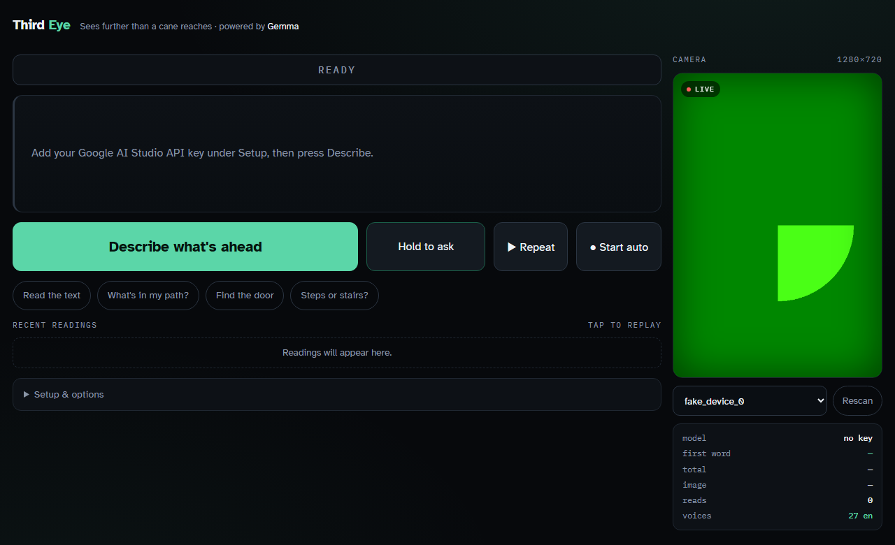

# Third Eye

**Sees further than a cane reaches.**

A camera assistant that tells a blind user what's ahead, judges whether the path is
walkable, and says what to do about it — out loud, powered by **Gemma** multimodal
vision through the Google AI Studio API.



---

## The problem

A white cane tells you about the ground within about **1.2 metres**, and only where the
tip actually sweeps. It finds nothing at waist, chest or head height — an open van door,
a cafe A-frame, scaffolding, a low branch. And it tells you nothing about what is coming
until you are already touching it.

Blind travellers navigate expertly within that 1.2 m. The gap is everything beyond it.

## What it does

Point the camera forward and press one button. Every reading returns three things:

```
ASSESS: STOP
SEE:    metal pole ahead, two steps, chest height
DO:     stop, move left to pass
```

- **A verdict** — `CLEAR`, `CAUTION` or `STOP`, spoken first
- **What it sees** — telegraphic, most urgent thing in the first three words, with
  direction, rough distance in steps, and height band
- **What to do** — a concrete physical instruction

You can also hold the mic and ask a free-form spoken question about whatever the camera
sees, or tap a preset.

| Action | Result |
|---|---|
| **Describe what's ahead** / tap the camera / `Space` | One-shot verdict, description and advice |
| **Start auto** | Continuous hands-free readings while you walk — see below |
| **Hold to ask** | Push-to-talk; ask anything about the current view |
| **Repeat** / `R` | Say the last reading again |
| `Escape` | Stop auto mode |
| Quick presets | Read the text · What's in my path · Find the door · Steps or stairs |
| Recent readings | Tap any past reading to hear it again — no extra API call |
| Camera panel | Switch cameras; **Rescan** picks up a Wi-Fi or virtual camera |

## Auto mode

Pressing a button for every reading defeats the point for someone walking, so auto mode
runs continuously. It is **a loop, not a timer**: the next frame is captured the moment
the previous reading has finished being spoken. No dead air waiting out an interval, and
no possibility of a slow reading stacking requests behind it. The rhythm self-adjusts —
a short `CLEAR / flat pavement / continue straight` comes round quickly, a longer one
takes longer.

Standing still would otherwise mean hearing "flat pavement ahead" over and over while
burning quota, so each frame is reduced to a **16×16 grayscale fingerprint** and compared
with the last one sent. Below a mean-absolute-difference threshold the request is skipped
entirely and the verdict shows `UNCHANGED`. Measured: sensor noise scores ~2, a real scene
change ~54, threshold 6.

A loop with no delay needs rails, so it also carries a 250 ms floor between iterations, a
1.5 s backoff that gives up after three consecutive errors, and a hard stop at 240
readings — a forgotten tab cannot drain an API quota overnight.

## Why Gemma

What a vision-language model does that an object detector cannot is answer **open-ended
questions about a scene it was never trained on**:

> "Is there a step at that doorway?"
> "What platform does that sign say?"
> "Which of these doors is the entrance?"

A detector returns a class label and a bounding box. Gemma returns an answer. That gap is
the entire premise of this project.

## Architecture

```mermaid
flowchart TD
    CAM["Camera<br/>getUserMedia"] --> GATE{"Scene changed?<br/>16x16 fingerprint"}
    GATE -- "no" --> SKIP["UNCHANGED<br/>no request spent"]
    GATE -- "yes" --> CROP["Portrait crop 9:16<br/>384px · JPEG q0.6 · ~15 KB"]
    MIC["Hold to ask<br/>SpeechRecognition"] --> REQ
    CROP --> REQ["user turn: image + contract<br/>model turn prefilled with 'ASSESS:'"]
    REQ --> API[["POST streamGenerateContent (SSE)"]]
    API --> GEMMA{{"GEMMA vision<br/>Google AI Studio"}}
    GEMMA -. "token stream" .-> PARSE["Line parser<br/>ASSESS → SEE → DO"]
    PARSE --> GUARD["Traffic guard<br/>blocks crossing verdicts"]
    GUARD --> VERDICT["Verdict pill<br/>CLEAR · CAUTION · STOP"]
    GUARD --> SEEN["Answer text"]
    GUARD --> ADVICE["DO bar"]
    GUARD --> LOG["Readings log<br/>tap to replay"]
    VERDICT --> TTS["Web Speech TTS<br/>verdict spoken first"]
    SEEN --> TTS
    ADVICE --> TTS
    TTS --> EAR(["User hears 'Stop.' in ~1 s"])
    EAR -. "auto mode: loop once speech ends" .-> CAM
    SKIP -. .-> CAM
```

Three details carry most of the design:

- **The verdict is the first line of the response**, and the stream is parsed line by
  line — so the one word that matters is spoken while the explanation is still
  generating.
- **The final turn in the request is the model's own, prefilled with `ASSESS:`.**
  Generation continues that text rather than starting a fresh reply, so the model cannot
  open with "the user wants me to describe this image". Gemma does that without the
  prefill; Gemini Flash does not need it. The prompt itself is deliberately short — long
  rule-lists are what invite a model to restate the task instead of answering.
- **The traffic guard sits after the model, not inside it.** A prompt is a request; this
  needs to be a requirement.

Model selection is resolved at runtime: the app calls `ListModels` with your key, ranks
Gemma vision models smallest-first, and picks the fastest available — so a changed or
retired model ID cannot break it.

## Latency is the product

A person who is walking cannot wait. The first working build took **46 seconds**. Five
changes brought it down:

1. **Streamed over SSE**, parsed line by line. `ASSESS` is the first and shortest line, so
   the user hears **"Stop."** about a second before the explanation arrives. *Time to
   first word* is the metric, not time to a finished sentence.
2. **Smallest capable Gemma vision model first.** A 4B model saying "kerb ahead, two
   steps" in 2 s beats a 31B model saying it beautifully in 40 s.
3. **384px frames at JPEG q0.6** — image tokens dominate prefill cost.
4. **48-token output cap**, prompt constrained to 15 telegraphic words.
5. **A new press aborts the request in flight**, so nothing queues behind a stale call.

The telemetry panel reports *first word*, *total* and *image KB* separately, so the
bottleneck is visible rather than guessed at.

## Judging the path, and the one thing it refuses

Third Eye **does** advise. For fixed things — obstacles, steps, kerbs, drop-offs, gaps,
doors — it gives a verdict and a concrete instruction, because those things don't move, a
two-second delay costs nothing, and that guidance is exactly what a sighted guide would
give.

The one judgement it refuses is **traffic**. It cannot see a car outside the frame, and in
the seconds between capture and speech that car has already arrived. So any road, kerb,
crossing or vehicle in view forces `CAUTION` or `STOP`, and the advice becomes *"wait, you
need a person to help you cross."* Phrases like "no cars", "traffic is clear" and "safe to
cross" are blocked in the prompt **and** again by an output filter in code — because a
prompt is a request, and this needs to be a requirement.

It also never claims something is absent, since the failure mode of a vision model is
missing things.

**This is an assistive supplement, not a mobility aid.** A cane or guide dog remains
primary. It is not a medical device.

## Design decisions

- **Vertical 9:16 camera panel**, and capture crops to match the preview exactly — what
  you see is what the model gets. That is also the right crop for walking: ground to head
  height in the path, no wasted pixels at the sides.
- **Replayable readings log.** A spoken answer is gone the moment it finishes; each
  reading stays on screen with its latency, and tapping it speaks again with no second
  API call.
- **Set in [Atkinson Hyperlegible](https://www.brailleinstitute.org/freefont)**, the
  typeface the Braille Institute designed for low-vision readers.
- **Operable without sight**: one large primary button, keyboard `Space`, tap-anywhere on
  the camera, live regions for screen readers, speech rate adjustable to 3×.

## Built with

Plain HTML, CSS and JavaScript — no framework, no build step, one file. Gemma multimodal
vision via the Google AI Studio API (`streamGenerateContent`, SSE). Web Speech API for
text-to-speech and push-to-talk recognition. `getUserMedia` + canvas for capture.

## Run it

```bash
git clone https://github.com/MD-ATIF-ALI-KHAN/hacktoberfest.git
cd hacktoberfest
python -m http.server 8000
```

Open <http://localhost:8000> and paste an API key from
[aistudio.google.com/apikey](https://aistudio.google.com/apikey) under **Setup**.

> One key covers both families — Google AI Studio issues a single key that serves **Gemma
> and Gemini**. There is no separate Gemma key, only a different model name.

The camera needs a secure context, so use `localhost`, or tunnel for phone testing:

```bash
cloudflared tunnel --url http://localhost:8000
```

The browser-side key here is fine for a demo but must never ship in a real app — proxy it
through a server.

## Honest limitations

- A cloud round trip cannot catch a fast-moving hazard. A production version needs an
  on-device reflex layer beneath this one — depth plus a detector, under 100 ms, driving
  haptics — with Gemma on the semantic layer where it is unbeatable.
- Motion blur while walking degrades accuracy; frames are not yet sharpness-gated.
- Not yet tested with blind users. Every decision about audio pacing and verbosity is a
  hypothesis until it is.

## Licence

Apache-2.0
